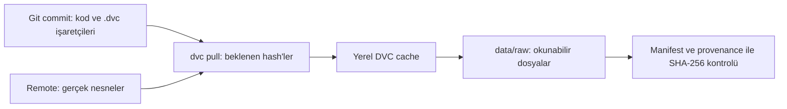

# DVC remote ve ham veri kimliği

## Bu çalışmada ne kurduk?

PTB-XL **1.0.3** için yerelde zaten bulunan 11 dosyayı sürümledik:
iki CSV, upstream checksum listesi, lisans, örnek Python dosyası ve üç
100 Hz EKG kaydının `.dat` / `.hea` çiftleri. Toplam **14.978.789 byte**.
Bu, PTB-XL'in tüm sinyallerini içermez. Önceki çalışmadaki küçük örnektir.
Türetilmiş `data/processed/` çıktıları bu adımın DVC kapsamına dahil değildir.

`docs/provenance.json` daha önce indirme kaynağını, veri sürümünü ve SHA-256
değerlerini kaydetmişti. Bu dosya Git'te kalır. Yeni ham veri manifesti
`data/manifests/ptbxl-1.0.3.json`, bu kayıttan doğrulanarak oluşturulur ve DVC'de tutulur.
Manifest zaman damgası içermez; aynı içerik aynı dosyayı üretir.

**Manifest bir envanterdir:** hangi dosyaların, hangi boyut ve checksum ile
beklendiğini söyler. **Artifact gerçek dosyadır:** örneğin EKG'nin `.dat` dosyası.
Sadece manifesti saklamak, kaybolan sinyali geri getirmez. Bu yüzden hem manifesti
hem ham klasörün tamamını DVC'ye ekledik.

## Dört ayrı yer

| Yer | İçerik | Git'e gider mi? |
| --- | --- | --- |
| `data/raw/ptb-xl/1.0.3/` | Uygulamanın okuyacağı gerçek ham dosyalar | Hayır |
| `data/raw/ptb-xl/1.0.3.dvc` ve `data/manifests/ptbxl-1.0.3.json.dvc` | Hash, boyut, hedef yol gibi küçük metadata | Evet |
| `.dvc/cache/files/md5/` | İçerik hash'i ile adreslenen yerel nesneler | Hayır |
| `.dvc-remote/ptbxl/files/md5/` | `dvc push` ile kopyalanan nesneler | Hayır |

`.dvc/config` paylaşılabilen ayarlardır. Bu kurulumda yalnızca analytics ayarı var.
`.dvc/config.local`, bu bilgisayara ait remote yolu ve varsayılan remote adını
tutar; Git tarafından ignore edilir. Yerel remote için erişim anahtarı gerekmez.
İleride bulut kullanırsan anahtarları paylaşılan config'e yazma; uygun kimlik
sağlayıcısı, ortam değişkeni veya yerel config kullan. Yerel config düz metindir,
şifreli kasa değildir.

Buradaki remote proje içindeki ayrı bir dizindir. DVC için "remote" başka
bilgisayar demek zorunda değildir. Bu bir eğitim düzenidir; aynı diskin veya
projenin silinmesine karşı yedek sağlamaz. Kalıcı kullanımda proje dışı,
tercihen ayrı disk/NAS/bulut deposu seç.

## Komut çalıştığında ne oluyor?

1. `python scripts/ptbxl_snapshot.py create`: ham dosyaları okur, SHA-256 ve
   boyutlarını Git'teki provenance ile karşılaştırır. Başarılıysa manifesti yazar.
   İnternetten indirme yapmaz, ham dosyaları değiştirmez.
2. `dvc add ...`: içerik hash'lerini hesaplar, cache'i doldurur ve `.dvc`
   işaretçilerini oluşturur/günceller. Git ignore kurallarını düzenleyebilir.
3. `dvc push`: cache nesnelerini remote'a aktarır. Git commit veya Git push yapmaz.
4. Sen metadata ve kodu aynı Git commit'ine koyarsın. Böylece commit, o kodla
   kullanılacak veri hash'ine işaret eder.
5. Başka klasörde `git clone`: kod ve `.dvc` metadata gelir. Ham EKG gelmez.
6. Remote tanımlayıp `dvc pull`: hash'lere karşılık gelen nesneler remote'dan
   cache'e alınır, ardından çalışma dosyaları oluşturulur.
7. `python scripts/ptbxl_snapshot.py verify`: geri gelen tüm dosyaları tekrar
   SHA-256 ile kontrol eder. "Komut başarılı oldu" yerine içerik eşitliğini sınar.



## Hash'i gerçekten anlamak

Hash, dosya içeriğinden hesaplanan sabit uzunlukta bir özettir. İçerikte bir
byte değişirse pratikte hash de değişir. Dosyanın adını veya yolunu değiştirmek,
tek başına dosyanın içerik hash'ini değiştirmez. Hash'ten dosyayı geri üretemezsin;
hash dosyanın sıkıştırılmış kopyası değildir. Çakışma matematiksel olarak mümkündür.

Bu DVC sürümü varsayılan nesne kimliği için **MD5** kullanıyor. `.dvc` içindeki
`md5` bunu gösterir. Bizim bağımsız bütünlük kontrolümüz **SHA-256** kullanır.
MD5'i kötü niyetli değişikliğe karşı güvenlik kanıtı olarak kullanmıyoruz.
SHA-256 eşitliği de kaynağın tıbbi doğruluğunu veya güvenilirliğini tek başına kanıtlamaz.

Ham klasörün işaretçisi `34122c6f89c8cc6ba37b392bb94be39a.dir`.
`.dir` nesnesi klasörün dosya yollarını ve dosya hash'lerini listeler.
Örneğin bu nesnenin remote yolu:
`.dvc-remote/ptbxl/files/md5/34/122c6f89c8cc6ba37b392bb94be39a.dir`.
Alt dosyalar kendi hash'leriyle ayrı nesneler halinde saklanır. Bir dosya
değiştiğinde yeni nesne ve yeni klasör indeksi oluşur; değişmeyen nesneler yeniden
kullanılabilir. Git'teki işaretçi güncellenir; remote otomatik temizlenmez.

## Kurulum ve günlük kullanım — PowerShell

Proje kökünde, mevcut bootstrap düzeniyle aynı ortamı kullan:

```powershell
$env:UV_CACHE_DIR = "$PWD/.uv-cache"
$env:UV_PYTHON_INSTALL_DIR = "$PWD/.uv-python"
$env:UV_PROJECT_ENVIRONMENT = "$PWD/.venv-3.12"
uv sync --locked --python 3.12

# Bu bilgisayardaki remote. --local, ayarı config.local'a yazar.
# Aynı isim zaten tanımlıysa yeniden add yerine remote modify kullan.
uv run --locked dvc remote add --local -d localstore "$PWD/.dvc-remote/ptbxl"
# uv run --locked dvc remote modify --local localstore url 'D:/dvc-storage/ptbxl'

# Mevcut verinin kimliğini oluştur; sonra gerçek dosyaları ve manifesti sürümle.
uv run --locked python scripts/ptbxl_snapshot.py create
uv run --locked dvc add data/raw/ptb-xl/1.0.3
uv run --locked dvc add data/manifests/ptbxl-1.0.3.json
uv run --locked dvc push
uv run --locked dvc status
uv run --locked dvc status --cloud
```

Yeni bir makinede veri henüz yoksa `create` çalıştırma; önce `dvc pull` çalıştır.
`create`, provenance ile uyuşmayan veriyi yeni sürüm diye sessizce kabul etmez.
Gerçek veri güncellemesinde kaynak/provenance ve sürüm politikasını ayrıca incele.

Yeni clone'da `config.local` gelmez. Aynı bilgisayarda orijinal remote'un **mutlak**
yolunu kullan; clone içindeki boş `.dvc-remote` klasörünü hedefleme.

```powershell
# Kullanıcı commit yaptıktan sonra, normal clone + pull kontrolü:
uv run --locked python scripts/verify_dvc_roundtrip.py --remote "$PWD/.dvc-remote/ptbxl"

# Commit öncesi prova: HEAD klonlanır, yalnızca gerekli bekleyen metadata kopyalanır.
uv run --locked python scripts/verify_dvc_roundtrip.py --remote "$PWD/.dvc-remote/ptbxl" --working-tree-snapshot
```

Betik her çalıştırmada `.dvc-lab/<benzersiz-id>/clone` oluşturur. Ham dosyaları,
manifest payload'unu, orijinal cache'i veya config.local'ı kopyalamaz. Önce boş
remote'a yönelterek `pull` hatasını kaydeder, sonra doğru remote'dan indirir ve
11 dosyayı doğrular. `result.json`, `broken-remote.log` ve `pull.log` aynı deney
klasöründe kalır. Yeni çalıştırma eskisini silmez; bu dizin Git'ten ignore edilir.

`--working-tree-snapshot` **commit edilmiş yeni sürümün temiz clone kanıtı değildir**.
Commit öncesi veri aktarımı provasıdır. Commit sonrası bayraksız komut, HEAD'teki
metadata ile aynı deneyi yaparak eksik Git dosyalarını da yakalar.

## Remote yolunu bozma: neyi öğreniyoruz?

Deneyde yalnızca ikinci clone'un yerel remote ayarı boş bir dizine değiştirilir.
Ana projenin remote'u ve verileri değişmez. Hata `missing` / `failed to fetch`
gibi mesajlarla DVC katmanında çıkar. Model kodu çalıştırılmadan veri getirilemez.

| Belirti | Önce bakılacak yer |
| --- | --- |
| No remote / yanlış yol / yetki hatası | Remote ayarı ve erişim |
| Missing cache files / failed to fetch | Remote'da beklenen nesne var mı? Push yapılmış mı? |
| Pull geçti, SHA-256 kontrolü geçmedi | Veri bütünlüğü, provenance ve manifest uyumu |
| Veri kontrolü geçti, Python traceback var | Uygulama/bağımlılık/girdi sözleşmesi; veri varlığı tek başına yeterli değil |

Eksik artifact mesajı tek başına nedenin yanlış yol mu yoksa eksik push mu
olduğunu söylemez. Ayarı ve remote içeriğini birlikte kontrol et.
Cache doluyken `pull` remote'a ihtiyaç duymadan başarılı olabilir; deneyin
başında bağımsız cache'in boş olması bu yüzden zorunlu.

## Remote silinirse hangi veri kaybolur?

Git'teki `.dvc` işaretçileri durur ama dosyayı yeniden oluşturamaz. Çalışma
klasöründe veya başka cache/remote/yedekte bulunan nesneler kurtarılabilir.
Kendi cache'inde olan sürümleri yeni remote'a `dvc push` ile taşıyabilirsin.
Yalnızca silinen remote'da kalmış eski sürümler kaybolur. Güncel çalışma
klasörünün durması bütün geçmiş sürümlerinin güvende olduğunu göstermez.
Upstream'den tekrar indirmek mümkün olsa da aynı içeriğin kalacağı garanti değildir.

## Deftere yaz

- Git commit'i kodu ve beklenen veri hash'lerini bağlar; dosya içeriği DVC deposundadır.
- `dvc add` → yerel cache + metadata; `dvc push` → remote; Git commit/push → metadata paylaşımı.
- Manifest envanterdir, artifact dosyadır; envanterden kayıp EKG üretilemez.
- MD5 DVC nesne adresidir; SHA-256 bu projedeki ek bütünlük kontrolüdür.
- `.dvc/config.local` Git'e gitmez; her clone remote erişimini ayrıca kurar.
- Remote'u bozma deneyinde boş cache kullan; aksi halde yerel veri hatayı gizleyebilir.
- Aynı disk üzerindeki remote veri aktarımını öğretir; disk arızasına karşı yedek değildir.
- Veri kimliği kontrolü geçmeden eğitime başlama; doğrulanmış veri yine de modelin doğru olduğunu kanıtlamaz.

Kendine sor: Git'te yalnızca hash varsa dosyanın byte'ları nereden geliyor?
Git'te eski commit'e dönünce neden ayrıca `dvc checkout` veya `dvc pull` gerekiyor?
Cache'te olmayan eski veri sürümü için remote'u kaybedersen ne yapabilirsin?

## Kaynaklar

- [DVC add](https://doc.dvc.org/command-reference/add): işaretçi ve cache oluşturma.
- [DVC remote add](https://dvc.org/doc/command-reference/remote/add): yerel dizin remote'u ve `--local`.
- [DVC pull](https://doc.dvc.org/command-reference/pull): remote → cache → çalışma klasörü.
- [DVC remote storage](https://doc.dvc.org/user-guide/data-management/remote-storage): depolama ve paylaşım.
